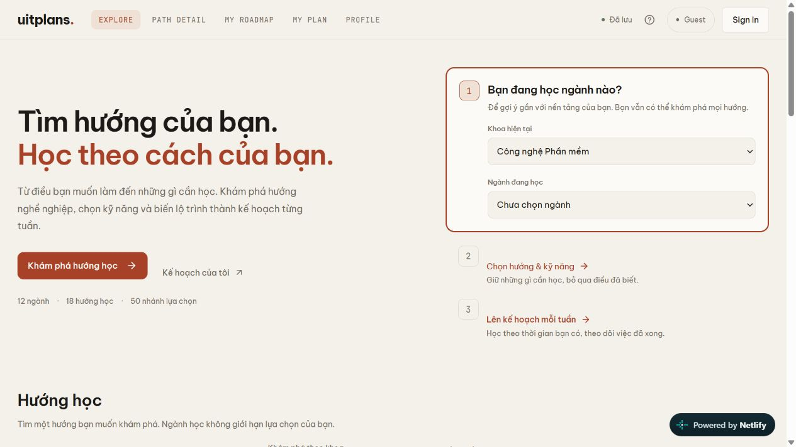

# uitplans.

**Find your path. Plan your week.**

A learning planner for students exploring careers in technology. Discover a direction, choose the skills and resources you need, and turn a roadmap into a weekly plan.

[Live application](https://uitplans.netlify.app/) · [System diagrams](https://uitplans.netlify.app/events.html) · [Learning catalogue](https://uitplans.netlify.app/catalog.html)



## Features

- **Explore:** 6 faculties, 12 majors, 18 career directions and 50 learning tracks. Your major helps prioritize suggestions without limiting your choices.
- **Path detail:** stages, learning resources, reference roadmaps and optional certification goals.
- **My roadmap:** choose stages, skip skills you already know, select resources and set your weekly study time.
- **My plan:** independent plans, daily tasks, notes, backlog, progress, week closing and read-only history. Regeneration includes a preview before replacing a schedule.
- **Profile:** learning activity, study preferences, time zone, JSON backup and recovery.
- **Guest or Google:** use Guest immediately, or sign in with Google to save an account workspace through Supabase. Guest import is explicit and previewed.
- **Diagrams:** 15 Activity, 8 Sequence and 44 Flowchart diagrams in one viewer, with direct links, zoom and printing.

Learning times are estimates and completion is self-reported. Certification goals link to external providers; uitplans does not issue certificates. Content packs retain their editorial review status.

## Quick start

Use Node.js **22.12 or newer** and npm.

```sh
npm ci
npm run dev
```

Open `http://127.0.0.1:5173/#/explore`. Guest works without a Supabase project. If the port is occupied, use `npm run dev -- --port 5195`.

To enable account features, copy `.env.example` to `.env.local` and supply your Supabase URL and publishable key. See [deployment and Google setup](docs/deployment.md). Never put an OAuth client secret or a Supabase service role key in frontend variables.

```sh
npm run check
npm run check:features
npm run build
npm run preview
```

Deploy the generated `dist/` directory to a static host. The application uses hash routes. Guest data belongs to the current browser origin, so export a backup before changing a domain or port.

## Architecture

React 19 · TypeScript · Vite · Supabase Auth/Postgres · IndexedDB

```text
Google ↔ Supabase Auth → account session
                              │
App shell → workspace controller → feature callbacks
                              │
                    domain + content packs
                              │
             Guest: IndexedDB │ Account: Supabase RPC
```

The domain layer is independent of React and storage. A mutation is acknowledged only after persistence confirms it. Account writes check the owner, expected revision and request ID; conflicts preserve the pending changes. Remote updates are polled while the page is visible. See [architecture](docs/architecture.md).

## Repository layout

| Directory | Purpose |
| --- | --- |
| `src/app`, `src/auth` | Workspace coordination, routing and account sessions |
| `src/features` | Explore, Path detail, My roadmap, My plan and Profile |
| `src/domain` | Contracts, planning, progress and validation |
| `src/content` | Catalogue and learning content packs |
| `src/persistence` | Guest/cloud storage, backup and migration |
| `supabase/migrations` | Database schema, RLS and workspace RPC |
| `scripts`, `tests` | Build helpers, regression checks and isolated browser fixtures |
| `public` | Static catalogue, diagrams and brand assets |
| `docs` | Architecture, setup, testing and content authoring |

## Documentation

- [Architecture and data lifecycle](docs/architecture.md)
- [Deployment and authentication](docs/deployment.md)
- [Testing and verification](docs/testing.md)
- [Content authoring](docs/architecture/HUONG_DAN_DU_LIEU.md)
- [Detailed event flows](docs/Luong_su_kien_chi_tiet.md)
- [Diagram sources and coverage](docs/diagrams/uml-20261011/README.md)
- [Contributing](CONTRIBUTING.md)

## Project context

Built as a mini project for **IS207 — Web Application Development**, University of Information Technology, VNU-HCM. Interface styling was inspired by Beaver Plans; learning resources and certifications remain owned by their respective providers. The browser favicon originates from the Beaver Plans reference and is not claimed as an original uitplans asset.

This repository contains the application and its technical documentation. Internal planning and presentation drafts are maintained separately.
